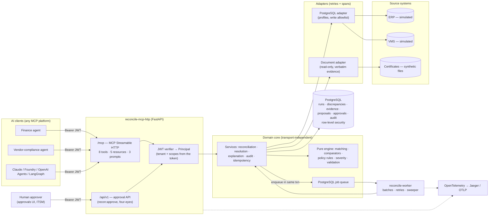
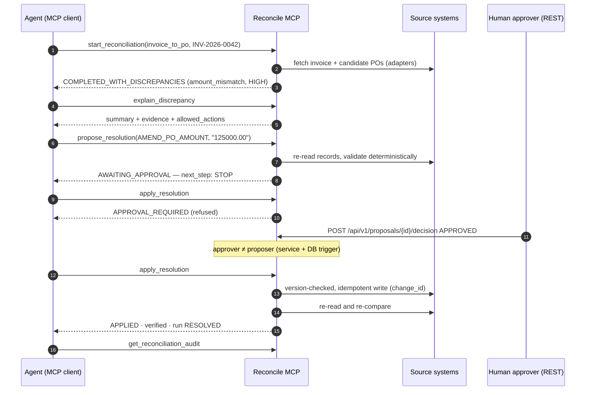

# Reconcile MCP — Architecture Decision Record & Implementation Plan

Status: **APPROVED 2026-11-12 — Slices 0–4 implemented** (designs and deviations: [Slice 2](slice-2-plan.md), [Slice 3](slice-3-plan.md), [Slice 4](slice-4-plan.md))
Date: 2026-11-12

---

## 0. Implementation notes (deviations from the original proposal)

Recorded so the document matches the code. Sections below are otherwise unchanged.

| Area | Proposed | Implemented | Why |
|---|---|---|---|
| Adapter contract | `fetch_related(ref, relation)` | `find_entities(entity_type, criteria, limit)` | Criteria are pushed down to the source and limited to declared fields; works for any source without named relations. |
| Adapter evidence | `get_evidence(ref, fields)` (re-fetch) | `get_evidence(record, fields)` | Evidence comes from the **same snapshot** that was compared, so evidence and discrepancy can never disagree. |
| `apply_update` | in base contract | deferred to Slice 2 | Added together with the approval workflow that gates it; no stub. |
| Candidate lookup | single filter | ordered `candidate_lookups` | Try exact PO number first (catches vendor mismatches), then the vendor's POs (lets normalized/fuzzy matching fix typos). |
| Fuzzy matching | threshold | accept + review thresholds + margin over runner-up | A one-character typo in a 6-character PO code scores 0.83 and is reported `ambiguous`, never merged. |
| Repositories | `db/repositories.py` | tenant-scoped queries inside services | One fewer layer; every query still filters on `tenant_id` and is covered by isolation tests. |
| Schemas | `interfaces/mcp/schemas.py` | `reconcile_mcp/schemas.py` | Result contracts are transport-independent; MCP and future REST share them. |
| Host ports | 5432 / 8000 | 55433 / 8090 | Avoid clashing with other local services; configurable. |
| Audit immutability | grants | `BEFORE UPDATE/DELETE/TRUNCATE` trigger | Holds regardless of database role. |

Local toolchain observed: Python 3.14.2, `uv`, Docker, `psql`.

---

## Architecture at a glance





---

## 1. MCP SDK research (verified 2026-11-12)

Verified against PyPI metadata, the downloaded `mcp==2.3.0` wheel source, and the
official docs at `py.sdk.modelcontextprotocol.io`.

| Fact | Value | Why it matters |
|---|---|---|
| Official SDK | `mcp` **2.3.0** (Python ≥3.10) | v2 is a breaking release vs. v1 |
| Server class | `from mcp.server import MCPServer` | v1 `mcp.server.fastmcp.FastMCP` **no longer exists**. Most tutorials online are v1 and will not run. |
| Protocol revision | **2026-07-28**, still serves 2025-11-25 clients | Older clients (and some hosted agent platforms) still speak 2025-era MCP; v2 negotiates both from one endpoint. |
| Transports | `stdio`, **Streamable HTTP**, SSE (superseded) | Streamable HTTP is the deployable transport; SSE is legacy only. WebSocket was removed. |
| ASGI | `mcp.streamable_http_app()` → Starlette app at `/mcp` | Can be mounted inside FastAPI; host app must run `mcp.session_manager.run()` in its lifespan. |
| Auth | `token_verifier=TokenVerifier` + `auth=AuthSettings(...)` | Server acts as an OAuth 2.1 **resource server**; serves RFC 9728 protected-resource metadata; 401 + `WWW-Authenticate` on missing token. |
| Reading identity in a tool | `get_access_token()` → `AccessToken(client_id, scopes, subject, claims, ...)` | Context-var based; returns `None` on stdio and in-memory clients. |
| Structured output | Return a Pydantic model → `structured_content` + generated output schema | Gives agents a typed contract, not prose. |
| Errors | `ToolError` → `is_error=True` result the model sees; `MCPError` → JSON-RPC error; other exceptions → generic error, traceback logged | We map domain errors deliberately (see §6.3). |
| Annotations | `ToolAnnotations(read_only_hint, destructive_hint, idempotent_hint, open_world_hint)` | **Hints only, not security.** We enforce permissions server-side. |
| Server middleware | `MCPServer(..., middleware=[...])` | Hook for correlation IDs, tracing, tool latency metrics. |
| Logging | MCP-level `ctx.info()` is deprecated in v2 | Use Python `logging` (structured), not protocol logging. |
| Testing | `async with Client(mcp) as c: await c.call_tool(...)` | In-memory contract tests without a network. |
| Body limit | 4 MiB per request | Keep tool payloads small; page discrepancy lists. |

**Decision:** use the official `mcp>=2.3,<3` package. Do **not** use the separate
third-party `fastmcp` 4.x package — it is a different project with its own API;
CLAUDE.md asks for the official SDK and one less dependency is one less risk.

---

## 2. Architecture decisions

### ADR-1 — One deployable process, two interfaces
A single FastAPI application hosts:
- `/mcp` — the MCP server (Streamable HTTP), consumed by AI agents.
- `/api/v1/...` — a small REST surface for **humans and platform systems**:
  approvals, health, readiness.

`stdio` is supported for local development (Claude Desktop / Claude Code / MCP Inspector).

*Why:* an enterprise platform integrates over the network with bearer tokens, so
Streamable HTTP is primary. A separate REST surface exists because some actions
(approving a correction) must **not** be performable by the agent.

### ADR-2 — Business logic is transport-independent
```
interfaces/mcp  ─┐
interfaces/http ─┼─▶ services (orchestration, transactions, audit)
                 │        │
                 │        ├─▶ engine (pure functions: match, compare, severity)
                 │        ├─▶ adapters (source systems)
                 │        └─▶ db (repositories, tenant-scoped)
```
The **engine has no I/O**: `compare(record_a, record_b, definition) → [DiscrepancyDraft]`.
That makes the core IP exhaustively unit-testable and lets the same logic run
from MCP, REST, a batch job, or a Celery worker.

### ADR-3 — Source systems are reached only through adapters
The simulated ERP lives in its own Postgres schema `erp_sim` (clearly labelled
*simulated*). The reconciliation engine **never** queries it directly; it goes
through `PostgresSourceAdapter`. Swapping in SAP or Dynamics later means writing a
new adapter, not touching the engine.

*Why separate schema, same database:* zero extra infra for the demo, but the code
boundary is identical to a real external system. The adapter could point at a
different DSN with a config change.

### ADR-4 — Reconciliation types are data, not code
A reconciliation type (e.g. `invoice_to_po`) is a versioned, Pydantic-validated
definition stored in `reconciliation_types.definition` (JSONB): which adapters and
entities to load, how to match them, which fields to compare with which
comparator, tolerances, mandatory fields and severity rules. Adding "contract vs.
CRM" is mostly a new definition plus comparators — this is what makes the server
*reusable across agents and customers* (the FDE "configure a template" model).

Example (abridged):
```yaml
key: invoice_to_po
version: 1
source_a: { data_source: erp_sim, entity: invoice }
source_b: { data_source: erp_sim, entity: purchase_order }
match:
  - { strategy: exact, a: po_number, b: po_number }
fields:
  - { name: amount,   a: total_amount, b: total_amount, comparator: money,
      currency_field: currency, tolerance: { absolute: "0.00" } }
  - { name: currency, a: currency,  b: currency,  comparator: exact_ci }
  - { name: vendor,   a: vendor_id, b: vendor_id, comparator: exact }
mandatory: [total_amount, currency, vendor_id, po_number]
severity:
  - { when: "field == 'amount' and abs_pct > 2",    level: HIGH }
  - { when: "field == 'amount' and abs_diff > 1000", level: HIGH }
  - { default: MEDIUM }
```
(The `when` clauses are illustrative; they will be a small typed rule model, not
`eval`'d strings.)

### ADR-5 — Deterministic core, LLM at the edges
Arithmetic, date comparison, tolerance checks, validation, permissions and
approvals are plain Python with `Decimal`. In the first slices there is **no LLM
call inside the server at all**: `explain_discrepancy` returns a deterministic,
evidence-backed structured explanation; the *agent's* LLM turns that into prose.
An optional server-side LLM narrative/extraction step can come later (documents).

### ADR-6 — The agent proposes, the backend disposes
- `explain_discrepancy` returns `allowed_actions` (a closed enum per discrepancy type).
- `propose_resolution` accepts only one of those actions + typed parameters + rationale.
- `validate_resolution` runs deterministic business rules.
- **Approval is a human act via REST** (`POST /api/v1/proposals/{id}/approval`) with
  scope `recon:approve`, and the approver must differ from the proposer.
- `apply_resolution` refuses unless an approval exists, the proposal is validated,
  and the target record's version still matches (optimistic concurrency).

*Why not an MCP `approve` tool?* Any tool exposed to the agent can be called by the
agent. Keeping approval off the agent's tool surface makes "the AI approved its own
change" structurally impossible, not merely discouraged by a prompt.

### ADR-7 — Identity comes from the token, never from tool arguments
No tool accepts `tenant_id`, `user_id` or `role`. A `Principal(tenant_id, subject,
client_id, scopes)` is built from `get_access_token()` claims. Scopes:

| Scope | Grants |
|---|---|
| `recon:read` | status, discrepancies, explanations, audit, resources |
| `recon:run` | start reconciliations |
| `recon:propose` | propose / validate resolutions |
| `recon:apply` | apply an *already approved* resolution |
| `recon:approve` | approve/reject (REST only; humans) |

Token verification: JWT (`pyjwt[crypto]`, already an SDK dependency). Dev/test uses
HS256 with a key from the environment and a CLI to mint tokens; production
configures a JWKS URL (e.g. Microsoft Entra ID) — same `TokenVerifier`, different
config. On **stdio** there is no token, so a dev principal is loaded from
environment **only when `RECONCILE_ENV=dev`**; otherwise stdio refuses to start.

### ADR-8 — Durable state machine now, background workers later
Runs follow `PENDING → RUNNING → COMPLETED | COMPLETED_WITH_DISCREPANCIES | FAILED`,
and later `AWAITING_APPROVAL → RESOLVED`. Every transition is a DB write with an
audit event in the same transaction.

In slice 1 the run executes **in-process** behind a `RunExecutor` interface (an
invoice/PO pair reconciles in milliseconds). `start_reconciliation` still returns
`run_id` + status, so the tool contract does not change when a Celery/Redis
executor replaces it in slice 4 for batch runs. *Why defer:* Celery + Redis add two
moving parts that demonstrate nothing until runs are large; the contract is what
must be right on day one.

### ADR-9 — Storage & drivers
- PostgreSQL 16, SQLAlchemy 2.x (async), Alembic.
- `psycopg` 3 for both async runtime and Alembic (one driver, sync + async).
- Money: `NUMERIC(18,4)` + `CHAR(3)` ISO-4217 currency, `Decimal` in Python. Never float.
- UUIDv4 primary keys; timestamps `TIMESTAMPTZ` in UTC.
- Python **3.12** in the Docker image (CLAUDE.md target; widest wheel support);
  `requires-python >=3.12` so local 3.14 also works.
- `uv` for dependency management and lockfile.

---

## 3. Folder structure

Deviations from CLAUDE.md §16, with reasons:
- `interfaces/mcp/` instead of top-level `tools/ resources/ prompts/` — groups
  everything transport-specific; a package literally named `mcp` would shadow the SDK.
- `engine/` for pure matching/comparison code, separate from `services/` that do
  I/O — the most important boundary in the project.
- `interfaces/http/` for the REST approval/health surface.

```text
reconcile-mcp/
├── CLAUDE.md
├── README.md
├── pyproject.toml              # uv-managed
├── uv.lock
├── Dockerfile
├── docker-compose.yml          # postgres (+ redis/worker in slice 4)
├── .env.example
├── alembic.ini
│
├── src/reconcile_mcp/
│   ├── config.py               # pydantic-settings, env-based, no secrets in code
│   ├── app.py                  # FastAPI app: mounts /mcp, /api/v1, lifespan
│   ├── logging.py              # structured JSON logs, correlation id contextvar
│   │
│   ├── domain/                 # Pydantic value objects & enums — no I/O
│   │   ├── records.py          # SourceRecord, FieldValue, EntityRef
│   │   ├── definitions.py      # ReconciliationDefinition (ADR-4)
│   │   ├── discrepancies.py    # DiscrepancyDraft, Severity, DiscrepancyStatus
│   │   ├── runs.py             # RunStatus + allowed transitions
│   │   ├── resolutions.py      # ResolutionAction, proposal states
│   │   └── errors.py           # typed domain errors
│   │
│   ├── engine/                 # pure, deterministic, exhaustively unit-tested
│   │   ├── matching.py         # exact / normalized / fuzzy (+confidence, reasons)
│   │   ├── comparators.py      # money, numeric_tolerance, date, exact_ci, ...
│   │   ├── severity.py
│   │   └── reconcile.py        # compare(a, b, definition) -> list[DiscrepancyDraft]
│   │
│   ├── services/               # orchestration: transactions, adapters, audit
│   │   ├── reconciliation_service.py
│   │   ├── explanation_service.py
│   │   ├── resolution_service.py      # slice 2
│   │   ├── idempotency.py
│   │   └── audit_service.py
│   │
│   ├── adapters/
│   │   ├── base.py             # SourceAdapter protocol, errors, capabilities
│   │   ├── registry.py         # data_source row -> adapter instance
│   │   ├── postgres.py         # simulated ERP (erp_sim schema)
│   │   └── documents.py        # slice 3: synthetic local documents
│   │
│   ├── db/
│   │   ├── models.py
│   │   ├── session.py
│   │   ├── repositories.py     # every query takes tenant_id
│   │   └── migrations/
│   │
│   ├── security/
│   │   ├── tokens.py           # JWT TokenVerifier (HS256 dev / JWKS prod)
│   │   └── principal.py        # Principal, require_scope()
│   │
│   └── interfaces/
│       ├── mcp/
│       │   ├── server.py       # MCPServer construction, middleware
│       │   ├── tools.py        # thin: validate -> principal -> service -> schema
│       │   ├── resources.py
│       │   ├── prompts.py
│       │   └── schemas.py      # tool input/output Pydantic models
│       ├── http/
│       │   └── routes.py       # approvals, health, readiness
│       └── stdio.py            # `reconcile-mcp-stdio` entry point (dev)
│
├── scripts/
│   ├── seed.py                 # synthetic tenants, vendors, POs, invoices
│   └── mint_token.py           # dev JWTs
│
├── tests/{unit,integration,contract}/
├── examples/{finance_agent,vendor_compliance_agent}/
├── sample_data/                # synthetic only
└── docs/
```

---

## 4. Database schema (first migration)

Principles:
- Every row carries `tenant_id`. Child tables reference parents with **composite
  foreign keys `(tenant_id, parent_id)`**, so the database itself rejects a
  discrepancy in tenant A pointing at a run in tenant B — isolation is enforced by
  constraints, not just by remembering a `WHERE` clause.
- `version INTEGER` on mutable rows for optimistic concurrency.
- `audit_events` is append-only (no UPDATE/DELETE grants for the app role).
- Postgres Row-Level Security is planned as defence-in-depth in the hardening slice.

`reconciliation_rules` (CLAUDE.md §12) is **deferred**: in slice 1 rules live inside
the versioned type definition (ADR-4). A separate table earns its place only once
rules are edited independently of types (per-tenant overrides).

```text
tenants
  id UUID PK, slug TEXT UNIQUE, name TEXT, created_at

data_sources
  id UUID PK, tenant_id FK, name TEXT, kind TEXT CHECK (postgres|documents),
  config JSONB            -- non-secret config; secrets referenced by env/secret name
  is_simulated BOOL NOT NULL, created_at
  UNIQUE (tenant_id, name), UNIQUE (tenant_id, id)

reconciliation_types
  id UUID PK, tenant_id FK NULL (NULL = platform template), key TEXT, version INT,
  definition JSONB NOT NULL, is_active BOOL, created_at
  UNIQUE (tenant_id, key, version)

reconciliation_runs
  id UUID PK, tenant_id, type_id FK, status TEXT CHECK (...),
  source_refs JSONB,         -- e.g. {"invoice": "INV-2026-0042"}
  requested_by TEXT,         -- principal subject
  client_id TEXT,            -- which agent/app
  correlation_id TEXT,
  summary JSONB, error JSONB,
  version INT, created_at, started_at, completed_at
  INDEX (tenant_id, status, created_at DESC)

reconciliation_entities      -- one row per matched (or unmatched) record pair
  id UUID PK, tenant_id, run_id FK(tenant_id, run_id),
  source_a_ref JSONB, source_b_ref JSONB NULL,
  match_method TEXT, match_confidence NUMERIC(4,3), match_reasons JSONB,
  match_status TEXT CHECK (matched|unmatched|ambiguous)

discrepancies
  id UUID PK, tenant_id, run_id FK, entity_id FK,
  field TEXT, rule_key TEXT, discrepancy_type TEXT,  -- amount_mismatch, missing_field...
  source_a_value JSONB, source_b_value JSONB, difference JSONB,
  severity TEXT CHECK (LOW|MEDIUM|HIGH|CRITICAL),
  reason TEXT, recommended_action TEXT,
  status TEXT CHECK (OPEN|PROPOSED|AWAITING_APPROVAL|RESOLVED|DISMISSED),
  fingerprint TEXT,          -- hash(run, entity, field, rule) -> no duplicate detections
  version INT, created_at
  UNIQUE (run_id, fingerprint), INDEX (tenant_id, run_id, severity)

evidence_records
  id UUID PK, tenant_id, discrepancy_id FK,
  data_source_id FK, source_system TEXT, record_ref TEXT, document_ref TEXT NULL,
  field_path TEXT, observed_value JSONB, excerpt TEXT NULL,
  content_hash TEXT,         -- detect if the source changed after observation
  observed_at TIMESTAMPTZ
  CHECK: every discrepancy must have >=1 evidence row (enforced in service + test)

resolution_proposals                         -- slice 2
  id UUID PK, tenant_id, discrepancy_id FK,
  action TEXT, params JSONB, rationale TEXT,
  proposed_by TEXT, proposed_by_client TEXT,
  status TEXT CHECK (PROPOSED|VALID|INVALID|AWAITING_APPROVAL|APPROVED|REJECTED|APPLIED|FAILED),
  validation_result JSONB, target_version TEXT, version INT, created_at

approvals                                    -- slice 2
  id UUID PK, tenant_id, proposal_id FK UNIQUE,
  decision TEXT CHECK (APPROVED|REJECTED), decided_by TEXT, comment TEXT, decided_at
  CHECK decided_by <> proposer (service-enforced; four-eyes)

audit_events
  id UUID PK, tenant_id, run_id NULL, subject_type TEXT, subject_id UUID,
  event_type TEXT, actor TEXT, client_id TEXT, correlation_id TEXT,
  payload JSONB, created_at
  INDEX (tenant_id, run_id, created_at), INDEX (tenant_id, subject_type, subject_id)

idempotency_records
  tenant_id, operation TEXT, key TEXT, request_hash TEXT,
  status TEXT CHECK (IN_PROGRESS|COMPLETED), response JSONB,
  resource_id UUID NULL, created_at, expires_at
  PK (tenant_id, operation, key)
```

Simulated ERP (`erp_sim` schema — labelled simulated, accessed only via adapter):
```text
erp_sim.vendors          (tenant_id, vendor_id, legal_name, tax_id, ...)
erp_sim.purchase_orders  (tenant_id, po_number, vendor_id, total_amount, currency, status, row_version)
erp_sim.invoices         (tenant_id, invoice_number, po_number, vendor_id, total_amount, currency, issued_on, row_version)
erp_sim.contracts        (tenant_id, contract_id, vendor_id, payment_terms, currency, status, row_version)   -- Slice 6
erp_sim.payment_schedules(tenant_id, schedule_id, contract_id, milestone_code, due_date, amount, currency)  -- Slice 6
```

Simulated CRM (`crm_sim` schema, Slice 6, migration `0005`):
```text
crm_sim.contracts (tenant_id, contract_id, account_name, counterparty_name, effective_date, renewal_date,
                   auto_renew, notice_period_days, contract_value, currency, status, row_version, last_change_id)
```

**Idempotency semantics:** same `(tenant, operation, key)` + same request hash →
return the stored response (no second run). Same key + different hash → error
`IDEMPOTENCY_KEY_REUSED`. Concurrent duplicate → the `IN_PROGRESS` row blocks via the
primary key; the loser gets `REQUEST_IN_PROGRESS` (retryable).

---

## 5. Adapter contract

```python
class Capability(StrEnum):
    READ = "read"; EVIDENCE = "evidence"; WRITE = "write"

@dataclass(frozen=True)
class AdapterContext:
    tenant_id: UUID           # from the authenticated principal, never the LLM
    correlation_id: str
    timeout_s: float

class EntityRef(BaseModel):
    data_source: str          # e.g. "erp_sim"
    entity_type: str          # e.g. "invoice"
    record_id: str            # e.g. "INV-2026-0042"

class SourceRecord(BaseModel):
    ref: EntityRef
    source_system: str
    fields: dict[str, Any]    # normalized names per adapter field map
    version: str              # etag/row_version for optimistic concurrency
    observed_at: datetime
    content_hash: str

class EvidenceItem(BaseModel):
    ref: EntityRef
    field_path: str
    observed_value: Any
    document_ref: str | None
    excerpt: str | None       # verbatim source text; never generated
    observed_at: datetime

class SourceAdapter(Protocol):
    kind: str
    capabilities: frozenset[Capability]

    async def fetch_entity(self, ctx: AdapterContext, ref: EntityRef) -> SourceRecord: ...
    async def fetch_related(self, ctx: AdapterContext, ref: EntityRef,
                            relation: str) -> list[SourceRecord]: ...
    async def get_evidence(self, ctx: AdapterContext, ref: EntityRef,
                           fields: Sequence[str]) -> list[EvidenceItem]: ...
    async def validate_reference(self, ctx: AdapterContext, ref: EntityRef) -> bool: ...
    async def apply_update(self, ctx: AdapterContext, ref: EntityRef,
                           changes: Mapping[str, Any], expected_version: str) -> SourceRecord: ...
```

Errors (typed, so the service decides retry vs. fail):
`RecordNotFound`, `AdapterUnavailable` (retryable), `AdapterTimeout` (retryable),
`VersionConflict`, `UnsupportedOperation` (e.g. `apply_update` on a read-only
document store), `InvalidReference`.

Rules for adapter authors: no business logic; translate source schema → normalized
fields via a declared field map; always tenant-scope; never raise bare exceptions.

---

## 6. MCP surface

### 6.1 The first six tools

All tools: Pydantic input + output models, tenant from the token, structured
results, stable IDs. "Scope" is enforced in code; annotations are hints.

| # | Tool | Scope | Annotations | Purpose |
|---|---|---|---|---|
| 1 | `start_reconciliation` | `recon:run` | not read-only, idempotent (with key) | Start a run for a configured type |
| 2 | `get_reconciliation_status` | `recon:read` | read-only | Status + summary counts |
| 3 | `list_discrepancies` | `recon:read` | read-only | Paged, filterable discrepancy list |
| 4 | `explain_discrepancy` | `recon:read` | read-only | Evidence-backed explanation + allowed actions |
| 5 | `propose_resolution` | `recon:propose` | not read-only, idempotent (with key) | Record a proposed action (does **not** change source data) |
| 6 | `validate_resolution` | `recon:propose` | read-only on sources | Deterministic validation of a proposal |

Follow-on (slice 2): `apply_resolution` (`recon:apply`, destructive) and
`get_reconciliation_audit` (`recon:read`). Approval is REST-only (ADR-6).

Shapes (abridged):

```python
# 1
class StartReconciliationInput(BaseModel):
    reconciliation_type: str            # "invoice_to_po"
    source_refs: dict[str, str]         # {"invoice": "INV-2026-0042"}
    idempotency_key: str = Field(min_length=8, max_length=128)
    options: RunOptions | None = None   # e.g. override tolerance within allowed bounds
class StartReconciliationOutput(BaseModel):
    run_id: UUID; status: RunStatus; discrepancy_count: int
    replayed: bool                      # true if served from idempotency store

# 2
class GetStatusInput(BaseModel): run_id: UUID
class RunStatusOutput(BaseModel):
    run_id: UUID; reconciliation_type: str; status: RunStatus
    entities_compared: int; discrepancies_by_severity: dict[Severity, int]
    started_at: datetime | None; completed_at: datetime | None; error: RunError | None

# 3
class ListDiscrepanciesInput(BaseModel):
    run_id: UUID; severity: list[Severity] | None = None
    status: list[DiscrepancyStatus] | None = None
    limit: int = Field(20, le=100); cursor: str | None = None
class DiscrepancySummary(BaseModel):
    discrepancy_id: UUID; entity_ref: str; field: str; discrepancy_type: str
    source_a_value: Any; source_b_value: Any; difference: Difference
    severity: Severity; status: DiscrepancyStatus; evidence_count: int
class ListDiscrepanciesOutput(BaseModel):
    items: list[DiscrepancySummary]; next_cursor: str | None

# 4
class ExplainDiscrepancyInput(BaseModel): discrepancy_id: UUID
class ExplainDiscrepancyOutput(BaseModel):
    discrepancy: DiscrepancySummary
    rule_applied: RuleDescription       # comparator, tolerance, why it fired
    match: MatchInfo                    # how records were paired, confidence, reasons
    evidence: list[EvidenceItem]        # source system, record id, field, value, observed_at
    allowed_actions: list[ActionSpec]   # closed set + parameter schema per action
    summary: str                        # deterministic template, e.g.
    # "Invoice INV-2026-0042 total INR 125,000.00 exceeds PO PO-7781 total
    #  INR 120,000.00 by INR 5,000.00 (4.17%); tolerance INR 0.00."

# 5
class ProposeResolutionInput(BaseModel):
    discrepancy_id: UUID
    action: ResolutionAction            # e.g. HOLD_INVOICE, AMEND_PO_AMOUNT, REQUEST_CREDIT_NOTE
    params: dict[str, Any]              # validated against the action's schema
    rationale: str = Field(max_length=2000)
    idempotency_key: str
class ProposeResolutionOutput(BaseModel):
    proposal_id: UUID; status: ProposalStatus; requires_approval: bool

# 6
class ValidateResolutionInput(BaseModel): proposal_id: UUID
class ValidateResolutionOutput(BaseModel):
    proposal_id: UUID; valid: bool
    checks: list[ValidationCheck]       # name, passed, detail
    requires_approval: bool; approval_reason: str | None
```

### 6.2 Resources & prompts
- Resources (slice 1): `reconciliation://types`, `reconciliation://runs/{run_id}`.
  Slice 2: `reconciliation://discrepancies/{run_id}`, `reconciliation://audit/{run_id}`,
  `reconciliation://rules`. Resources are tenant-scoped exactly like tools.
- Prompts: `reconcile_financial_records` (slice 2), `investigate_vendor_compliance`
  (slice 3), `resolve_reconciliation_exceptions`. They describe the workflow
  (start → list → explain → propose → validate → stop and request approval); they
  never replace server-side checks.

### 6.3 Error model
| Situation | Mechanism | Agent sees |
|---|---|---|
| Bad input shape | SDK schema validation | tool error |
| Unknown run / discrepancy, or one in another tenant | `ToolError("NOT_FOUND: ...")` | same message for both — no cross-tenant existence leak |
| Missing scope | `ToolError("FORBIDDEN: requires recon:run")` | clear, actionable |
| Idempotency key reuse with different payload | `ToolError("IDEMPOTENCY_KEY_REUSED")` | |
| Adapter unavailable / timeout | run → `FAILED`, `error.retryable=true` | status shows reason |
| Unexpected exception | logged with correlation id; generic tool error | no internals leaked |

Every tool error string starts with a stable machine code so agents can branch on it.

---

## 7. How external MCP clients connect

| Client | Transport | Auth |
|---|---|---|
| MCP Inspector / Claude Code / Claude Desktop (dev) | stdio (`uv run reconcile-mcp-stdio`) or HTTP | dev principal (stdio) / dev JWT (HTTP) |
| Enterprise agent platforms (e.g. Azure AI Foundry agents, Claude API MCP connector, OpenAI Agents SDK, LangGraph) | Streamable HTTP `https://<host>/mcp` | `Authorization: Bearer <JWT>` issued by the customer IdP |
| Our own example agents (`examples/`) | Python `mcp.Client("http://.../mcp")` | minted JWT per agent identity |

Flow: client → `/mcp` → `TokenVerifier` validates signature/issuer/audience/expiry →
`AccessToken` placed in context → tool resolves `Principal` → scope check →
service call with `tenant_id` from the principal. Clients discover the auth server
via `/.well-known/oauth-protected-resource/mcp`.

Each agent gets its own `client_id`, so the audit trail shows *which agent* did
what on behalf of *which user*. Hosted-platform specifics (e.g. Foundry's remote
MCP tool header configuration) will be verified against their current docs when we
write `docs/integration.md`.

---

## 8. Security & reliability risks

| Risk | Mitigation |
|---|---|
| LLM injects another tenant's ID | No tenant/user fields in any tool input; tenant from token only |
| Cross-tenant reference via guessed UUID | Tenant-scoped repositories + composite FKs + identical NOT_FOUND response; RLS later |
| Prompt injection via document/evidence text | Evidence returned as data fields, never concatenated into server-side prompts; server takes no instructions from source content |
| Agent approves its own change | Approval not exposed as an MCP tool; four-eyes check; separate scope |
| Agent applies a high-impact change directly | `apply_resolution` requires APPROVED proposal + VALID validation + version match |
| Stale correction (record changed since review) | `target_version` captured at proposal; `apply_update(expected_version=…)` → `VersionConflict` |
| Duplicate tool calls / client retries | Idempotency keys on all state-changing tools; unique discrepancy fingerprints |
| Partial failure mid-run | Run state + discrepancies written in one transaction; failure → `FAILED` with typed error; stuck `RUNNING` runs detected by lease timeout (slice 4) |
| Adapter hangs | Per-call timeouts; retry with backoff only for retryable errors |
| Float rounding in money | `Decimal` + `NUMERIC`; currency mismatch never compared numerically |
| Fuzzy match silently merges wrong records | Below threshold → `ambiguous`, surfaced as a discrepancy, never auto-matched |
| Fabricated evidence | Evidence rows only created from adapter output; `excerpt` is verbatim; test asserts every discrepancy has evidence |
| Host-header / DNS-rebinding attacks on HTTP | SDK `TransportSecuritySettings(allowed_hosts, allowed_origins)` |
| Secret leakage | Env/secret manager only; `data_sources.config` holds no secrets; logs redact tokens |
| Tool annotations mistaken for security | Documented as hints; scopes enforced server-side |
| Audit tampering | Append-only table; app role lacks UPDATE/DELETE; audit written in the same transaction as the change |

---

## 9. Implementation plan

Each slice ends runnable, tested, and documented. Nothing is mocked and presented
as real; the simulated ERP is labelled as such everywhere.

### Slice 0 — Foundation (≈ day 1)
- `pyproject.toml` (uv), `config.py`, structured logging with correlation IDs.
- `docker-compose.yml` with Postgres 16 (app DB + test DB).
- SQLAlchemy models + **first Alembic migration**: `tenants`, `data_sources`,
  `reconciliation_types`, `reconciliation_runs`, `reconciliation_entities`,
  `discrepancies`, `evidence_records`, `audit_events`, `idempotency_records`,
  and the `erp_sim` tables.
- `scripts/seed.py`: two tenants (`acme-india`, `globex`) with synthetic data —
  vendor V-1001, PO-7781 ₹120,000, INV-2026-0042 ₹125,000; plus a clean matching
  pair and a currency-mismatch pair; tenant B gets look-alike IDs to prove isolation.
- **Done when:** `docker compose up` + `alembic upgrade head` + seed works from clean.

### Slice 1 — Detect & explain invoice ↔ PO (≈ days 2–3) — *the first vertical slice*
- `domain/` models; `engine/` matching (exact + normalized), comparators (money with
  currency guard, exact_ci, numeric tolerance), severity rules, `compare()`.
- `PostgresSourceAdapter` over `erp_sim` (read + evidence).
- `ReconciliationService`: idempotent start → load records via adapter → match →
  compare → persist entities, discrepancies, evidence, audit events in one
  transaction → final status.
- `ExplanationService`: deterministic explanation + `allowed_actions`.
- Security: JWT `TokenVerifier`, `Principal`, scope checks, `mint_token.py`,
  dev stdio principal.
- MCP: `MCPServer` with tools 1–4, resources `types` and `runs/{id}`, mounted in
  FastAPI at `/mcp`; stdio entry point.
- Tests:
  - unit: exact match, normalized match, ₹5,000 amount mismatch, within-tolerance,
    currency mismatch, missing mandatory field, severity thresholds.
  - integration (real Postgres): end-to-end run, idempotent replay, key reuse with
    different payload, tenant B cannot see tenant A's run, adapter record-not-found
    → typed failure, every discrepancy has evidence.
  - contract: `mcp.Client` lists exactly the expected tools with schemas; call
    flow start → list → explain returns the expected structured output; missing
    scope → FORBIDDEN.
- **Demo:** MCP Inspector or a short script: start `invoice_to_po` for
  INV-2026-0042 → one HIGH `amount_mismatch` of INR 5,000.00 (4.17%) with evidence
  from both records.

### Slice 2 — Resolve with approval (≈ days 4–5)
- Migration: `resolution_proposals`, `approvals`.
- Tools 5–6 + `apply_resolution`, `get_reconciliation_audit`; REST approval endpoint.
- Deterministic validation rules (e.g. `AMEND_PO_AMOUNT` must equal invoice amount,
  must not exceed vendor credit limit, requires approval above ₹1,000).
- Optimistic-concurrency write-back through the adapter; audit trail.
- Prompt `reconcile_financial_records`; `examples/finance_agent` (Claude API agent
  using the remote MCP server) demonstrating the 7-step finance scenario.
- Tests: approval enforcement, self-approval rejected, apply without approval
  rejected, version conflict, duplicate apply, audit completeness.

### Slice 3 — Documents & vendor compliance (≈ day 6)
- `DocumentSourceAdapter` over synthetic certificates in `sample_data/` (structured
  front-matter + text; deterministic extraction first, LLM extraction optional and
  clearly flagged).
- `vendor_certificate_expiry` type: date comparator, expiry-window rule.
- `examples/vendor_compliance_agent` using the **same** tool interface.

### Slice 4 — Async & reliability hardening
- Redis + Celery executor behind `RunExecutor`; retries with backoff; run leases
  and stuck-run recovery; OpenTelemetry traces/metrics via SDK middleware; RLS.

### Slice 5 — Packaging & docs
- Dockerfile, full compose, CI (lint, type-check, tests against Postgres),
  `README`, `docs/tools.md`, `docs/integration.md`, `docs/demo.md`.

### Slice 6 — Contract-to-system reconciliation (Use Case B)
- Generic engine additions: derived fields with provenance; line-item reconciliation.
- Simulated CRM (`crm_sim`), ERP contracts and payment schedules; synthetic contract documents with a
  milestone table. Types `contract_to_crm` and `contract_to_erp`; prompt `review_contract_obligations`;
  a third agent on the same 8 tools. Design record: [slice-6-plan.md](slice-6-plan.md).

### Slice 7 — Customer configuration
- Tenant versions as validated patches on platform templates; lifecycle draft → active → retired
  (migration `0006`: status, `based_on_id`, `replaced_id`, `patch`, a trigger making activated versions
  immutable, one active version per tenant and key). Dry run, activate, rollback over a REST admin API
  (`recon:admin`); `reconciliation://rules/{key}` for agents. Design record: [slice-7-plan.md](slice-7-plan.md).

---

## 10. Decisions I'd like confirmed

1. **Approval via REST only** (not an MCP tool) — recommended (ADR-6).
2. **Defer Celery/Redis to slice 4**, keeping the async-ready contract — recommended (ADR-8).
3. **Simulated ERP as an `erp_sim` schema in the same Postgres** — recommended (ADR-3).
4. **Example agents built on the Claude API** calling the server over Streamable HTTP
   (no agent framework) — recommended; swappable for Azure AI Foundry later.
5. **Defer `reconciliation_rules` table**; rules live in versioned type definitions (§4).
