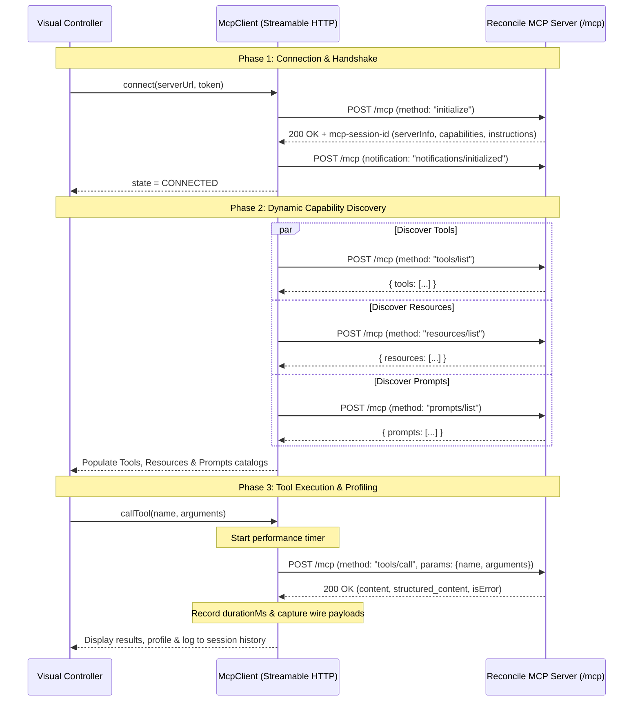

# Reconcile Frontend — Independent MCP Controller Architecture

## 1. Overview & Separation of Concerns

The **Reconcile MCP Visual Controller** is an enterprise-grade, independently deployable control plane and visual console for the **Reconcile MCP** server.

### Architectural Independence
- **Zero Backend Coupling**: The frontend is a standalone React application that acts as an MCP client. It does not import or share code with the Python backend.
- **Protocol-First Communication**: All interactions between the frontend controller and the server occur strictly across the standard **Model Context Protocol (MCP)** specification over **Streamable HTTP** (`JSON-RPC 2.0`).
- **Dynamic Discovery (No Hardcoding)**: Tool schemas, addressable resources, and workflow prompt templates are queried dynamically from the server at connection time via `tools/list`, `resources/list`, and `prompts/list`.
- **Tenant Isolation & Security**: The frontend inherits tenant scope, user principal, and role authorizations exclusively from the injected OAuth / JWT Bearer token via the `Authorization: Bearer <token>` HTTP header.

---

## 2. MCP Transport & Protocol Specification

### 2.1 Transport Layer: Streamable HTTP
The Python server exposes its MCP surface at `/mcp` using `mcp.server.MCPServer.streamable_http_app()`. The visual controller connects using standard HTTP POST requests with support for both synchronous JSON responses and asynchronous Server-Sent Events (SSE).

#### Request Framing:
```http
POST /mcp HTTP/1.1
Host: localhost:8000
Content-Type: application/json
Accept: application/json, text/event-stream
Authorization: Bearer <jwt-token>
mcp-session-id: <session-id-if-established>

{
  "jsonrpc": "2.0",
  "id": 1,
  "method": "initialize",
  "params": {
    "protocolVersion": "2024-11-05",
    "clientInfo": {
      "name": "reconcile-mcp-controller",
      "version": "1.0.0"
    },
    "capabilities": {
      "roots": { "listChanged": true },
      "sampling": {}
    }
  }
}
```

#### Response Parsing:
1. **JSON Response (`Content-Type: application/json`)**: Standard JSON-RPC 2.0 response containing `result` or `error`.
2. **SSE Response (`Content-Type: text/event-stream`)**: The controller reads SSE frames (`event: message\ndata: {...}\n\n`) and extracts the encapsulated JSON-RPC result.
3. **Session Tracking**: When the server returns the `mcp-session-id` header in the HTTP response, the client caches it and includes it in subsequent requests.

---

## 3. Connection & Discovery Lifecycle



---

## 4. Discovered Capabilities in Reconcile MCP

### 4.1 Tools Catalog (`tools/list`)
| Tool Name | Type | Scope | Description |
| :--- | :--- | :--- | :--- |
| `start_reconciliation` | Mutate / Idempotent | `recon:run` | Start a reconciliation run for a single record (`source_refs`) or batch (`selection`). |
| `get_reconciliation_status` | Read Only | `recon:read` | Retrieve run status, timing, discrepancy counts by severity, and worker metrics. |
| `list_discrepancies` | Read Only | `recon:read` | Query discrepancies found during a run with optional severity/status filtering. |
| `explain_discrepancy` | Read Only | `recon:read` | Deterministic explanation of a discrepancy with verbatim source evidence excerpts. |
| `propose_resolution` | Mutate / Idempotent | `recon:propose` | Propose corrective action (e.g. `HOLD_PAYMENT`, `AMEND_PO_AMOUNT`) with instant validation. |
| `validate_resolution` | Mutate / Idempotent | `recon:propose` | Re-evaluate proposal rules against fresh live source data to detect superseded state. |
| `apply_resolution` | Mutate / Destructive | `recon:apply` | Apply an approved proposal to external systems via adapters (enforces four-eyes approval). |
| `get_reconciliation_audit` | Read Only | `recon:read` | Return chronological append-only audit trail with correlation IDs. |

### 4.2 Resources Catalog (`resources/list`)
- `reconciliation://types`: Available reconciliation types (`invoice_to_po`, `vendor_certificate_compliance`, `contract_to_crm`, `contract_to_erp`).
- `reconciliation://rules/{key}`: Tenant-scoped rules, tolerances, severity matrices, and approval policies for a given type.
- `reconciliation://runs/{run_id}`: Detailed status and timing metrics for a specific run.
- `reconciliation://discrepancies/{run_id}`: First 100 discrepancies detected in a run.
- `reconciliation://audit/{run_id}`: First 200 chronological audit events for a run.
- `reconciliation://proposals/{proposal_id}`: Full proposal record including validations and approval state.

### 4.3 Prompts Catalog (`prompts/list`)
- `reconcile_financial_records`: Guided system instructions for reconciling invoices against purchase orders.
- `resolve_reconciliation_exceptions`: Workflow instructions for continuing an existing run and applying approved proposals.
- `investigate_vendor_compliance`: Instructions for auditing vendor liability insurance against uploaded certificates.
- `review_contract_obligations`: Instructions for verifying executed contracts against CRM and ERP systems.

---

## 5. Dynamic Schema Form Generation

The controller dynamically generates user input forms directly from any tool's JSON Schema (`inputSchema`):
- **Strings**: Rendered as `<input type="text">` or `<textarea>` with parameter descriptions.
- **Enums**: Rendered as `<select>` dropdowns with exact schema-allowed options.
- **Booleans**: Rendered as interactive switches/toggles.
- **Numbers / Integers**: Rendered as `<input type="number">`.
- **Complex Objects & Arrays**: Rendered as JSON textareas with real-time JSON syntax checking and formatting.
- **Rapid Testing Presets**: Dedicated 1-click buttons inject valid sample payloads for `invoice_to_po` single-record reconciliation, batch runs, payment holds, and credit note proposals.

---

## 6. Execution Profiling & Wire Payload Auditing

Every tool invocation is tracked with full observability:
1. **Wall-Clock Duration**: Measured in high-resolution milliseconds (`performance.now()`).
2. **Text Content Inspector**: Formatted display of textual output lines and logs returned by the server.
3. **Structured Content Tree**: Interactive, syntax-highlighted viewer for machine-readable JSON returned in `structured_content`.
4. **Wire Frame Capture**: Dual JSON viewer tabs displaying the exact outbound `JSON-RPC Request` and inbound `JSON-RPC Response` payloads with request IDs and header metadata.
5. **Session Execution History**: In-memory audit table recording all tool executions in chronological order, with one-click payload inspection and re-run capabilities.

---

## 7. Connectivity, Browser Boundaries & Connection Gateway

### 7.1 Browser Same-Origin Policy & CORS
When running in a standard web browser:
1. **Local Development (Direct Origin)**: The Reconcile MCP server permits origins matching `http://localhost:*` by default. Connecting directly to `http://localhost:8000/mcp` succeeds out of the box.
2. **Local Development (Vite Proxy)**: The frontend's Vite dev server configures a reverse proxy:
   ```ts
   server: {
     proxy: {
       '/mcp': {
         target: 'http://127.0.0.1:8000',
         changeOrigin: true
       }
     }
   }
   ```
   Users can connect to `/mcp` directly without CORS friction.

### 7.2 Remote & Cross-Domain Deployment (Connection Gateway)
If connecting to a remote MCP server hosted on another domain where CORS headers (`Access-Control-Allow-Origin`, `Access-Control-Allow-Headers`) are not exposed, direct browser `fetch` will be rejected by the browser security sandbox.

**Recommended Solution: Separately Deployable Connection Gateway**
Rather than modifying the Python MCP server, deploy a lightweight connection gateway (e.g. Node.js, Cloudflare Worker, or Envoy proxy) that acts as a secure bridge:

```
[Browser MCP Controller]
         |
         | HTTP / CORS
         v
[MCP Connection Gateway (Node.js / Edge Worker)]
         |
         | Streamable HTTP / Stdio
         v
[Reconcile MCP Server]
```

#### Minimal Connection Gateway Example (Node.js / Express):
```javascript
import express from 'express';
import cors from 'cors';
import fetch from 'node-fetch';

const app = express();
app.use(cors({ origin: true, credentials: true }));
app.use(express.json());

const TARGET_MCP = process.env.MCP_SERVER_URL || 'http://127.0.0.1:8000/mcp';

app.post('/mcp-gateway', async (req, res) => {
  try {
    const upstream = await fetch(TARGET_MCP, {
      method: 'POST',
      headers: {
        'Content-Type': 'application/json',
        'Accept': req.headers['accept'] || 'application/json, text/event-stream',
        ...(req.headers['authorization'] ? { 'Authorization': req.headers['authorization'] } : {}),
        ...(req.headers['mcp-session-id'] ? { 'mcp-session-id': req.headers['mcp-session-id'] } : {})
      },
      body: JSON.stringify(req.body)
    });

    if (upstream.headers.get('mcp-session-id')) {
      res.setHeader('mcp-session-id', upstream.headers.get('mcp-session-id'));
    }

    res.status(upstream.status);
    upstream.body.pipe(res);
  } catch (err) {
    res.status(502).json({ jsonrpc: '2.0', error: { code: -32000, message: err.message } });
  }
});

app.listen(3001, () => console.log('MCP Connection Gateway listening on port 3001'));
```

---

## 8. Verification & Test Coverage

The frontend MCP Controller includes automated unit and integration tests verifying:
- JSON-RPC 2.0 request generation and response parsing.
- MCP initialization handshake and session ID caching.
- Tool listing (`tools/list`) and dynamic execution (`tools/call`).
- Execution duration calculation and payload capture.
- Resource reading (`resources/read`) and prompt retrieval (`prompts/get`).
- SSE stream chunk parsing for streaming servers.
- Accurate detection and user-friendly error formatting for HTTP 401 Unauthorized, 403 Forbidden, and browser CORS failures.

All tests run via `npm test` and pass without warnings.

